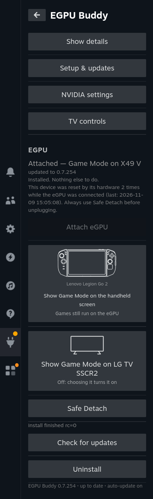
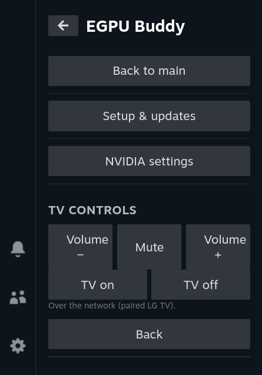
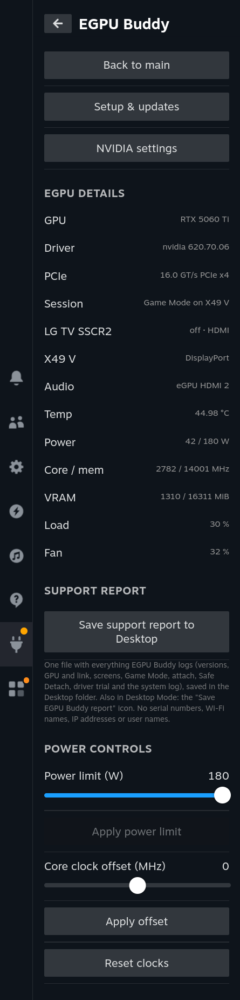
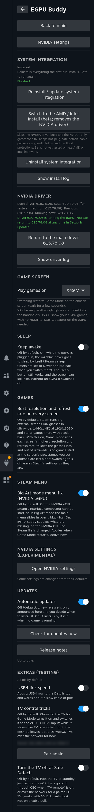
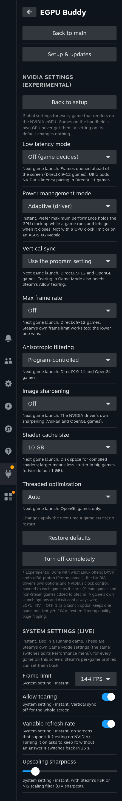
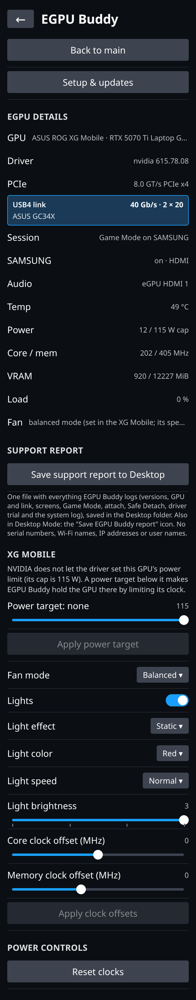
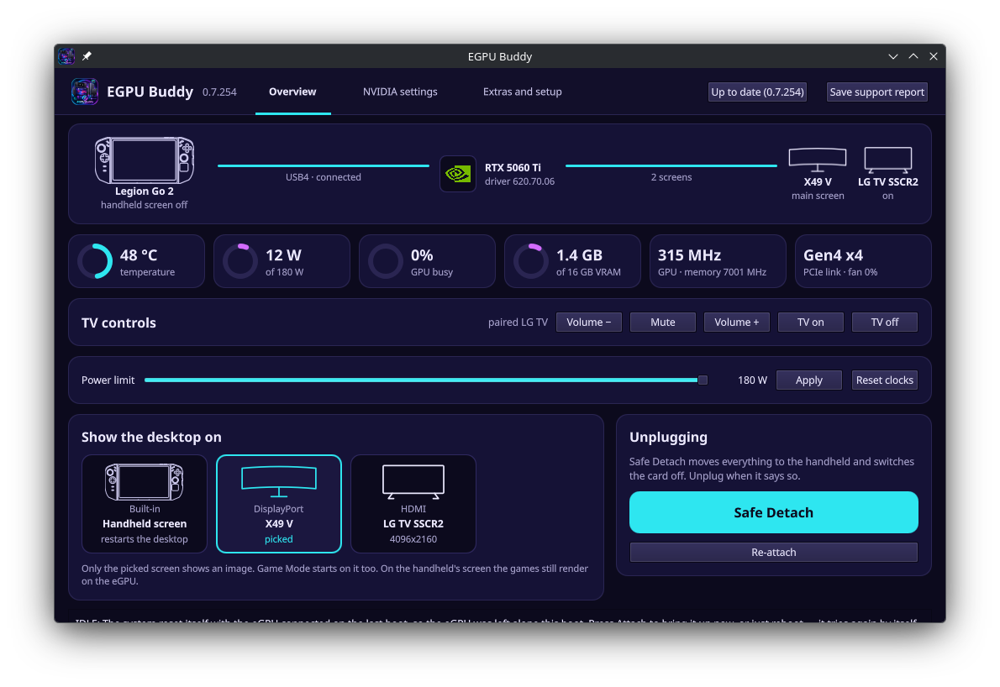
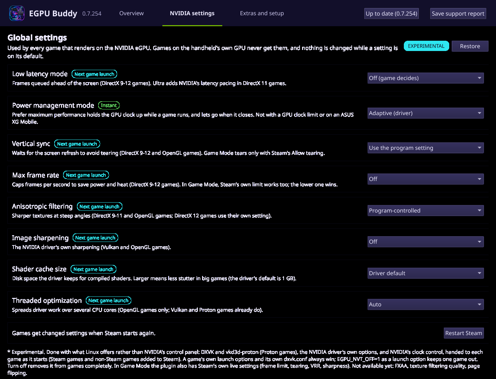
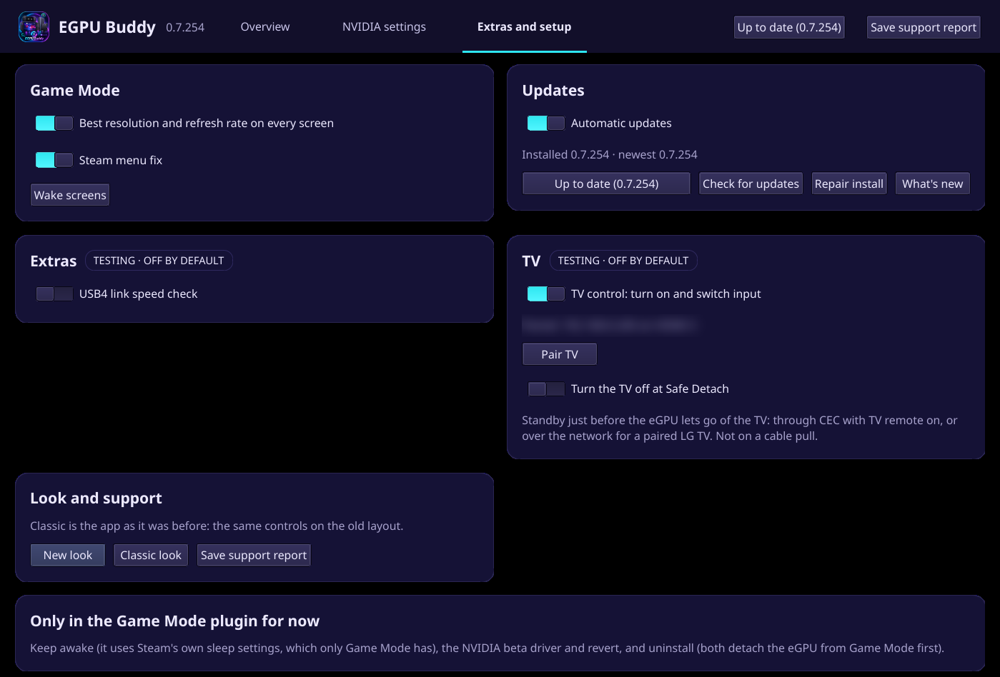

<p align="center">
  
</p>

<p align="center">
  <a href="https://discord.gg/r3dhqAqnW"></a>
  <a href="https://denver8989.github.io/EGPU-Buddy/"></a>
</p>

# EGPU Buddy

**[Watch the EGPU Buddy presentation](https://denver8989.github.io/EGPU-Buddy/)** — Opening demo and narrated walkthrough, with a Skip intro button.

Use an eGPU with a Linux gaming handheld in **Game Mode**, the way it works on Windows: plug it in and Game Mode
moves to your monitor or TV; unplug it, safely or by pulling the cable, and it goes back to the handheld screen;
plug it in again and it comes back. It's all controlled from a Decky plugin in the Quick Access menu.

NVIDIA eGPUs are fully supported, including the fix for NVIDIA's Game Mode display glitches. AMD and Intel eGPUs
are supported in beta (RX 6800 XT, RX 6750 XT, RX 9070 and RX 9070 XT tested by users).

> **Use at your own risk.** This changes the NVIDIA driver, boot settings and the Game Mode session. It has been
> tested on the machines below and nothing else. Read [TESTED.md](TESTED.md) first, and keep a way to boot without
> the eGPU. Claude (Anthropic) and Codex (OpenAI) were used as development assistants.

## Features

- **Fixes NVIDIA's Game Mode display glitches:** no more striping, flicker or corrupted picture in Game Mode on
  NVIDIA cards (a gamescope fix built and shipped with the plugin).
- **Plug and play in Game Mode:** the eGPU is picked up automatically and Game Mode moves to its screen.
- **Safe Detach:** one button moves Game Mode back to the handheld screen; then unplug.
- **Cable pulls survive:** the handheld recovers to its own screen within seconds, and plugging in again re-attaches.
- **Multiple displays:** switch Game Mode between connected screens from the plugin. A new screen brings up a prompt,
  and each screen shows its name, port, resolution and refresh rate. The desktop follows the same choice, and the
  desktop app has the same screen picker (SteamOS and CachyOS with an NVIDIA eGPU): on the handheld's screen the
  desktop runs on the handheld's GPU alone and games still render on the eGPU.
- **Best picture by default:** each screen's native resolution at its highest refresh rate.
- **Screens wake and switch input** where they support it (DDC/CI or HDMI-CEC).
- **TV controls (opt-in):** control the TV from the plugin and the desktop app, for a paired LG TV over the network or
  over HDMI-CEC through SteamOS's own CEC service:
  - volume, mute, TV on and TV off, and "Switch TV to the eGPU";
  - when Game Mode or the desktop moves to the TV, it is turned on (only if it is off) and switched to the eGPU's input,
    whatever HDMI number that is;
  - the TV switched off at Safe Detach.
  HDMI-CEC works with an AMD card's HDMI port or a CEC-capable DisplayPort-to-HDMI adapter, a USB-CEC adapter on any
  eGPU, and on NVIDIA cards through a CEC-capable DisplayPort-to-HDMI adapter with EGPU Buddy's patched driver
  ("NVIDIA CEC" in Extras).
- **GPU details and controls:** temperature, power, clocks, VRAM, power limit and clock offset.
- **NVIDIA settings (experimental):** the Windows NVIDIA control panel's global settings (low latency, V-sync, frame
  limit, anisotropic filtering, sharpening, shader cache size, power mode) for games on the NVIDIA eGPU, in the desktop
  app and the plugin, plus Steam's own live Game Mode settings (frame limit, tearing, VRR, sharpness).
- **Big Art mode menu fix (NVIDIA, opt-in):** on an NVIDIA eGPU Steam's own interface compositor can't start, so with
  Steam's Big Art home layout (Steam client, October 2026) the main menu slides in over a black bar. EGPU Buddy supplies
  what it is missing, on the NVIDIA GPU, without changing any Steam file; the plugin offers it while Big Art mode is on
  ([#7](https://github.com/denver8989/EGPU-Buddy/issues/7)).
- **ASUS XG Mobile support** (ROG Xbox Ally X tested): attach, Safe Detach and cable pulls in both modes, plus
  XG Mobile controls in the plugin and the desktop app: a power target in watts, fan modes and a custom fan curve, the
  dock's lights, and core and memory clock offsets.
- **NVIDIA driver 615 (main):** offered once after the update on 610 machines, with an automatic return to 610 if it fails.
- **Beta driver 620 (testers):** NVIDIA 620.70.06 with the same eGPU patches, tried from 615 with an automatic return to 615 if it fails.
- **Keeps itself working:** Decky restarts if it stops, and the setup repairs itself after OS updates.
- **Release notes when updating:** "What's new" in the plugin and in the desktop app's Update window, straight from
  GitHub: every version between the one you have and the update.
- **Desktop app** with the same controls for the docked desktop.

## Screenshots

### The NVIDIA Game Mode fix

<p align="center">
  
</p>
<p align="center"><sub>Before: photo by bernhard.berger,
<a href="https://forums.developer.nvidia.com/t/display-modes-above-2560x1440p-120hz-with-hdr-enabled-cause-flickering-corruption-within-gamescope-session/295314">NVIDIA developer forum</a>.
After: image by Valve, <a href="https://www.steamdeck.com/en/software">steamdeck.com</a>.
Fix: gamescope GBM scan-out route by NightHammer1000 and antheas; root cause found by matt-schwartz (see <a href="CREDITS.md">CREDITS.md</a>).</sub></p>

### The Decky plugin in Game Mode

<p align="center"><sub>Taken in Game Mode on a Legion Go 2 with an RTX 5060 Ti (0.7.254).</sub></p>
<table align="center">
  <tr>
    <th width="33%" valign="top">Main page<br><sub>Switch Game Mode between the handheld, a TV and a monitor; TV controls; Safe Detach.</sub></th>
    <th width="33%" valign="top">TV controls<br><sub>Volume, mute, TV on and off: a paired LG TV, or HDMI-CEC.</sub></th>
    <th width="33%" valign="top">Details<br><sub>GPU, driver, PCIe link, screens, live readings, support report, power limit and clocks.</sub></th>
  </tr>
  <tr>
    <td valign="top"></td>
    <td valign="top"></td>
    <td valign="top"></td>
  </tr>
  <tr>
    <th width="33%" valign="top">Setup &amp; updates<br><sub>System integration, NVIDIA driver, game screen, keep awake, best resolution, Steam menu fix, updates, extras (TV).</sub></th>
    <th width="33%" valign="top">NVIDIA settings<br><sub>The control panel's global settings for games on the eGPU, plus Steam's live Game Mode settings.</sub></th>
    <th width="33%" valign="top">ASUS XG Mobile<br><sub>RTX 5070 Ti Laptop GPU on a ROG Xbox Ally X: power target, fan mode, lights, clock offsets.</sub></th>
  </tr>
  <tr>
    <td valign="top"></td>
    <td valign="top"></td>
    <td valign="top"></td>
  </tr>
</table>

### The desktop app

<p align="center">
  
</p>
<p align="center"><sub>Overview: the handheld, the eGPU and its screens at a glance, live readings, TV controls, the power limit, the
screen the desktop and Game Mode show on (only the picked screen shows a picture), and Safe Detach. The version and the update button stay at the top.</sub></p>

<table align="center">
  <tr>
    <th width="50%" valign="top">NVIDIA settings<br><sub>Low latency, power mode, vertical sync, frame limit, filtering, sharpening, shader cache.</sub></th>
    <th width="50%" valign="top">Extras and setup<br><sub>The Game Mode settings, updates, the TV card (control, pairing, TV off at Safe Detach), the look and the support report.</sub></th>
  </tr>
  <tr>
    <td valign="top"></td>
    <td valign="top"></td>
  </tr>
</table>

<p align="center"><sub>The classic look is one click away in Extras and setup.</sub></p>

## Tested hardware

| Handheld | OS | eGPU | Screens | Status | Tested by |
|---|---|---|---|---|---|
| Legion Go 2 | CachyOS (Deckify), SteamOS | Gigabyte AORUS AI Box, RTX 5060 Ti | Acer X49 ultrawide (DP), LG TV (HDMI) | **Fully working** (reference machine) | denver8989 (maintainer) |
| Legion Go 2 (Ryzen Z2) | Bazzite 44 (bazzite-deck) | Gigabyte AORUS AI Box, RTX 5060 Ti | Samsung Odyssey G95SC (HDMI) | **Fully working**: every feature verified | 1khanfusion |
| Legion Go 1 | SteamOS 3.8 | AOOSTAR AG03, RTX 3080 | Acer X49 ultrawide (DP) | Tested | denver8989 (maintainer) |
| ROG Xbox Ally X | SteamOS 3.8+ | ASUS XG Mobile 2025, RTX 5070 Ti Laptop GPU | TV (HDMI) | Tested | SilverplayerX |
| Legion Go S (Ryzen Z1 Extreme) | SteamOS 3.10 | Trebleet Thunderbolt 3 enclosure (Intel JHL7440), AMD RX 9070 XT | Fire TV (HDMI, via a CEC-capable DP-to-HDMI adapter) | **Beta**: plug-in, Game Mode on the TV and Safe Detach work (CEC crash fixed in 0.7.251); boot with the eGPU (0.7.253) and desktop Safe Detach (0.7.254) being confirmed | ming |
| Legion Go 1 | SteamOS 3.9 | AOOSTAR AG02, AMD RX 6800 XT | MSI MP275 (HDMI) | **Beta**: plug-in, unplug and games work; sleep and performance fixes being confirmed | RetroMann |
| Legion Go 1 | CachyOS (Deckify) | Minisforum DEG2, PowerColor AMD RX 9070 | Samsung TV (HDMI) | **Beta**: Game Mode works; heavy games crash (open AMD driver problem with RX 9000 over USB4) | zergpoop |
| Legion Go 1 | CachyOS (Deckify) | TB3 enclosure (Intel JHL7440), AMD RX 6750 XT | monitor (HDMI) | **Beta**: desktop works; Game Mode on the eGPU being looked at | Ivan C.nunes |

Details per machine: [TESTED.md](TESTED.md). Testers and contributors: [CREDITS.md](CREDITS.md).

**Operating systems:** SteamOS 3.8 to 3.10, CachyOS (Deckify) and **Bazzite** (handheld image, bazzite-deck) tested; Bazzite fully working. On Bazzite the patched NVIDIA driver is built on the device for its kernel (no
NVIDIA driver needed from Bazzite) and the NVIDIA picture fix is built into the gamescope Bazzite ships.

**NVIDIA:** RTX 30 and RTX 50 tested here (desktop cards, and a laptop RTX 50 in an XG Mobile); RTX 40 reported working by a user (RTX 4070). **AMD and Intel eGPUs:**
beta, testing in progress on an AMD RX 6800 XT, RX 6750 XT, RX 9070 and RX 9070 XT (choose "AMD / Intel" at the first install). Reports are welcome. Details: [docs/TECHNICAL.md](docs/TECHNICAL.md).

## Install

**Keep the eGPU unplugged while installing and for the reboot after.** The protections it needs only take effect
after a reboot.

1. **From Game Mode (recommended):** with [Decky Loader](https://decky.xyz) installed, go to Decky settings →
   Developer → **Install plugin from URL**, and paste the `EGPU-Buddy-Decky-<version>.zip` link from
   [Releases](https://github.com/denver8989/EGPU-Buddy/releases). Open **EGPU Buddy** in the Quick Access
   menu, press **Install system integration**, then reboot.
2. **From the Desktop:** download `SteamOS-EGPU-Buddy-<version>.run` from
   [Releases](https://github.com/denver8989/EGPU-Buddy/releases), make it executable and run it, then reboot.
3. **One line in a terminal:**
   ```
   curl -fsSL https://raw.githubusercontent.com/denver8989/EGPU-Buddy/master/get-egpu-buddy.sh | bash
   ```

After the reboot, plug the eGPU in. Updates are offered in the plugin and the desktop app, each with its release notes
("What's new in …"); automatic updates are off unless you turn them on. Every release stays available on the
Releases page.

## NV GPU Buddy (experimental): desktop PCs and laptops with an NVIDIA card

A second mode of the same app for machines whose NVIDIA card is **built in**: a desktop PC, or a laptop with NVIDIA
graphics. It keeps everything that is not about plugging an eGPU in: NVIDIA settings, power and clock controls, the Big
Art menu fix, best resolution and refresh rate, screens and TV control, Keep awake, the support report and updates, with
EGPU Buddy's patched NVIDIA driver. In this mode the plugin and the desktop app are called **NV GPU Buddy**.

- **Who it is for:** SteamOS, CachyOS or Bazzite in Game Mode on a desktop PC or laptop with a GeForce card. Also a desktop
  PC that is getting one: the driver is installed first, and the card works from its first boot.
- **Never on a handheld:** a handheld always gets the normal eGPU install, also one EGPU Buddy does not know yet.
- **Install:** the plugin's **Install system integration** offers NV GPU Buddy on such a machine, with two confirmations.
  From a terminal: `./install.sh` from the release tarball asks the same.
- **Bazzite:** use an image without NVIDIA's driver built in (for example `bazzite-deck`, not `bazzite-deck-nvidia`).
- **Updates:** it only takes the releases marked "NV GPU Buddy" in their notes.
- **Status:** NOT tested on a desktop PC or laptop yet. If you try it, send a support report (Details > Save support
  report) through an issue or Discord.

## Reporting problems

Open an [issue](https://github.com/denver8989/EGPU-Buddy/issues) with your handheld, OS, eGPU and GPU, the
version (`cat /etc/nv-egpu-buddy/version`), and whether the eGPU was plugged in at boot or later. Logs worth
attaching are listed in [docs/TECHNICAL.md](docs/TECHNICAL.md#reporting-problems).

## Credits

This builds on other people's work. Full details, with links and licenses: [CREDITS.md](CREDITS.md).

- **Testers:** SilverplayerX, 1khanfusion, ming, RetroMann, zergpoop, Ivan C.nunes, and akamel001 and bbauti on GitHub (details in [CREDITS.md](CREDITS.md)).
- **seerge ([G-Helper](https://github.com/seerge/g-helper)), RomanYazvinsky** and
  **[Handheld Daemon](https://github.com/hhd-dev/hhd):** the XG Mobile's USB control protocol (fan, lights).
- **matt-schwartz:** found the root cause of the NVIDIA Game Mode corruption.
- **NightHammer1000** and **antheas:** the gamescope fix this project builds.
- **NickNill, bdandy, roger-pmta:** the hot-unplug-safe NVIDIA driver patches.
- **Themaister ([PyroWave](https://github.com/Themaister/pyrowave)), relil:** the Performance boost (M3).
- **Ilya Zlobintsev ([LACT](https://github.com/ilya-zlobintsev/LACT)):** the base of the GPU controls.
- **damianbienias32**, the **open-gpu-kernel-modules #979** contributors, **nikomiiller** and **Alex Forencich:** the
  USB4 link stability fixes.
- **ewagner12 ([all-ways-egpu](https://github.com/ewagner12/all-ways-egpu)):** the `boot_vga` technique used for
  AMD/Intel eGPUs.
- **xXJSONDeruloXx ([cec-mote](https://github.com/xXJSONDeruloXx/cec-mote)):** the approach of the TV remote over
  HDMI-CEC (volume, mute, TV on / off through SteamOS's CEC service).
- **Valve** (gamescope, Proton), **dxvk-nvapi**, **Decky Loader**, **CachyOS**, **Bazzite** and **NVIDIA**.

If your work is used here and isn't credited, open an issue and it will be fixed.

## More

- [docs/TECHNICAL.md](docs/TECHNICAL.md): how it works, OS updates, AMD/Intel details, kernel parameters.
- [TESTED.md](TESTED.md): what has been tested, and how.
- [docs/ROOT-CAUSES.md](docs/ROOT-CAUSES.md): the bugs behind the fixes.
- [RELEASE-NOTES.md](RELEASE-NOTES.md): what changed in each version.

## License

MIT for the scripts and documentation here. Vendored patches keep their upstream licenses (see
[CREDITS.md](CREDITS.md)).
