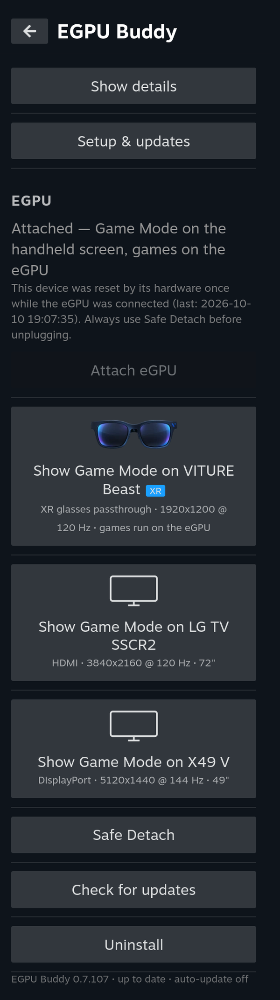
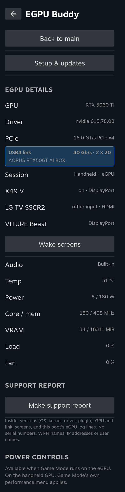
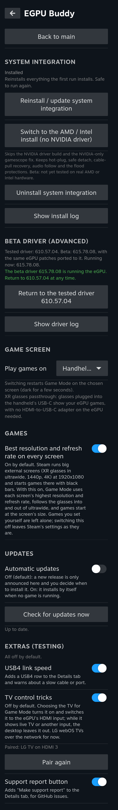
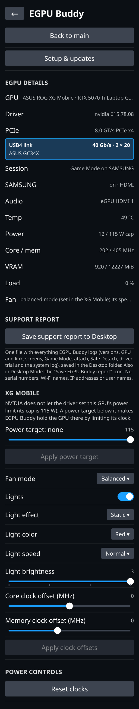
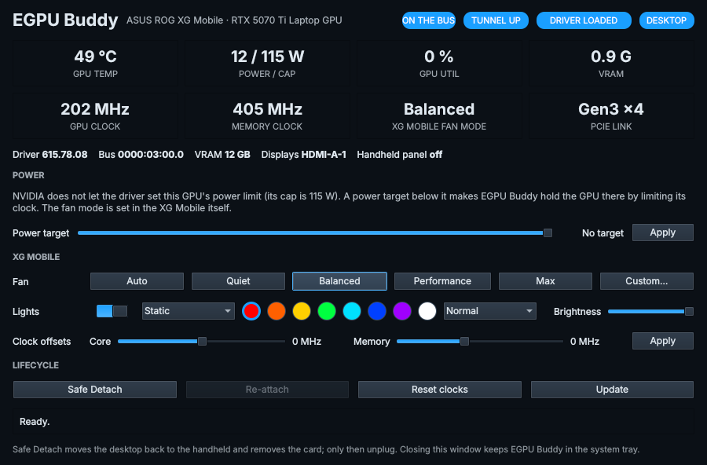

<p align="center">
  
</p>

<p align="center">
  <a href="https://discord.gg/r3dhqAqnW"></a>
</p>

# SteamOS EGPU Buddy

Use an eGPU with a Linux gaming handheld in **Game Mode**, the way it works on Windows: plug it in and Game Mode
moves to your monitor or TV; unplug it, safely or by pulling the cable, and it goes back to the handheld screen;
plug it in again and it comes back. It's all controlled from a Decky plugin in the Quick Access menu.

NVIDIA eGPUs are fully supported, including the fix for NVIDIA's Game Mode display glitches. AMD and Intel eGPUs
are supported in beta (an RX 6800 XT is being tested now).

> **Use at your own risk.** This changes the NVIDIA driver, boot settings and the Game Mode session. It has been
> tested on four machines (below) and nothing else. Read [TESTED.md](TESTED.md) first, and keep a way to boot without
> the eGPU. Claude (Anthropic) and Codex (OpenAI) were used as development assistants.

## Features

- **Fixes NVIDIA's Game Mode display glitches:** no more striping, flicker or corrupted picture in Game Mode on
  NVIDIA cards (a gamescope fix built and shipped with the plugin).
- **Plug and play in Game Mode:** the eGPU is picked up automatically and Game Mode moves to its screen.
- **Safe Detach:** one button moves Game Mode back to the handheld screen; then unplug.
- **Cable pulls survive:** the handheld recovers to its own screen within seconds, and plugging in again re-attaches.
- **Multiple displays:** switch Game Mode between connected screens from the plugin. A new screen brings up a prompt,
  and each screen shows its name, port, resolution and refresh rate.
- **Best picture by default:** each screen's native resolution at its highest refresh rate.
- **Screens wake and switch input** where they support it (DDC/CI or HDMI-CEC).
- **GPU details and controls:** temperature, power, clocks, VRAM, power limit and clock offset.
- **ASUS XG Mobile support** (ROG Xbox Ally X tested): attach, Safe Detach and cable pulls in both modes, plus
  XG Mobile controls in the plugin and the desktop app: a power target in watts, fan modes and a custom fan curve, the
  dock's lights, and core and memory clock offsets.
- **Beta driver button:** try NVIDIA's newest driver, with an automatic return to the tested one if it fails.
- **Keeps itself working:** Decky restarts if it stops, and the setup repairs itself after OS updates.
- **Release notes when updating:** "What's new" in the plugin and in the desktop app's Update window, straight from
  GitHub: every version between the one you have and the update.
- **Desktop app** with the same controls for the docked desktop.

## Screenshots

<p align="center">
  
  &nbsp;
  
  &nbsp;
  
</p>
<p align="center"><em>Main page (switch between the handheld, XR glasses, TV and monitor; Safe Detach), details (GPU, link, screens, telemetry) and setup (game screen, best resolution, updates, extras).</em></p>

<p align="center">
  
  &nbsp;
  
</p>
<p align="center"><em>ASUS XG Mobile (RTX 5070 Ti Laptop GPU) on a ROG Xbox Ally X, in the Game Mode plugin (left) and the desktop app (right):
power and its 115 W cap, a power target, the XG Mobile's fan mode and custom curve, its lights and clock offsets.
Readings from SilverplayerX's device.</em></p>

<p align="center">
  
</p>
<p align="center"><em>The NVIDIA Game Mode bug EGPU Buddy fixes. Before: photo by bernhard.berger,
<a href="https://forums.developer.nvidia.com/t/display-modes-above-2560x1440p-120hz-with-hdr-enabled-cause-flickering-corruption-within-gamescope-session/295314">NVIDIA developer forum</a>.
After: image by Valve, <a href="https://www.steamdeck.com/en/software">steamdeck.com</a>.
Fix: gamescope GBM scan-out route by NightHammer1000 and antheas; root cause found by matt-schwartz (see <a href="CREDITS.md">CREDITS.md</a>).</em></p>

## Tested hardware

| | Legion Go 2 | Legion Go 2 (Ryzen Z2) | Legion Go 1 | ROG Xbox Ally X | Legion Go 1 (AMD eGPU) |
|---|---|---|---|---|---|
| OS | CachyOS (Deckify) | Bazzite 44 (handheld image, bazzite-deck) | SteamOS 3.8 | SteamOS 3.8 | SteamOS 3.9 |
| eGPU | Gigabyte AORUS AI Box, RTX 5060 Ti | Gigabyte AORUS AI Box, RTX 5060 Ti | AOOSTAR AG03, RTX 3080 | ASUS XG Mobile 2025, RTX 5070 Ti Laptop GPU | AOOSTAR AG02, AMD RX 6800 XT |
| Screens | Acer X49 ultrawide (DisplayPort), LG TV (HDMI) | Samsung Odyssey G95SC ultrawide (HDMI) | Acer X49 ultrawide (DisplayPort) | TV (HDMI) | MSI MP275 (HDMI) |
| Status | Tested | Tested (on-device testing: 1khanfusion) | Tested | Tested (on-device testing and development: SilverplayerX) | **Testing in progress** (on-device testing: RetroMann): plug-in, unplug and games work; sleep and performance fixes being confirmed ([TESTED.md](TESTED.md)) |

**Operating systems:** SteamOS 3.8 and 3.9, CachyOS (Deckify) and **Bazzite** (handheld image, bazzite-deck) tested. On Bazzite the patched NVIDIA driver is built on the device for its kernel (no
NVIDIA driver needed from Bazzite) and the NVIDIA picture fix is built into the gamescope Bazzite ships.

**NVIDIA:** RTX 30 and RTX 50 tested here (desktop cards, and a laptop RTX 50 in an XG Mobile); RTX 40 reported working by a user (RTX 4070). **AMD and Intel eGPUs:**
beta, testing in progress on an AMD RX 6800 XT (choose "AMD / Intel" at the first install). Reports are welcome. Details: [docs/TECHNICAL.md](docs/TECHNICAL.md).

## Install

**Keep the eGPU unplugged while installing and for the reboot after.** The protections it needs only take effect
after a reboot.

1. **From Game Mode (recommended):** with [Decky Loader](https://decky.xyz) installed, go to Decky settings →
   Developer → **Install plugin from URL**, and paste the `EGPU-Buddy-Decky-<version>.zip` link from
   [Releases](https://github.com/denver8989/EGPU-Buddy/releases). Open **EGPU Buddy** in the Quick Access
   menu, press **Install system integration**, then reboot.
2. **From the Desktop:** download `SteamOS-EGPU-Buddy-<version>.run` from
   [Releases](https://github.com/denver8989/EGPU-Buddy/releases), make it executable and run it, then reboot.
3. **One line in a terminal:**
   ```
   curl -fsSL https://raw.githubusercontent.com/denver8989/EGPU-Buddy/master/get-egpu-buddy.sh | bash
   ```

After the reboot, plug the eGPU in. Updates are offered in the plugin and the desktop app, each with its release notes
("What's new in …"); automatic updates are off unless you turn them on. Every release stays available on the
Releases page.

## Reporting problems

Open an [issue](https://github.com/denver8989/EGPU-Buddy/issues) with your handheld, OS, eGPU and GPU, the
version (`cat /etc/nv-egpu-buddy/version`), and whether the eGPU was plugged in at boot or later. Logs worth
attaching are listed in [docs/TECHNICAL.md](docs/TECHNICAL.md#reporting-problems).

## Credits

This builds on other people's work. Full details, with links and licenses: [CREDITS.md](CREDITS.md).

- **SilverplayerX** (Discord): on-device testing and development on the ROG Xbox Ally X with the ASUS XG Mobile.
- **1khanfusion** (Discord): on-device testing of Bazzite on the Legion Go 2.
- **RetroMann** (Discord): on-device testing of the AMD eGPU path (Legion Go 1, AOOSTAR AG02, RX 6800 XT).
- **seerge ([G-Helper](https://github.com/seerge/g-helper)), RomanYazvinsky** and
  **[Handheld Daemon](https://github.com/hhd-dev/hhd):** the XG Mobile's USB control protocol (fan, lights).
- **matt-schwartz:** found the root cause of the NVIDIA Game Mode corruption.
- **NightHammer1000** and **antheas:** the gamescope fix this project builds.
- **NickNill, bdandy, roger-pmta:** the hot-unplug-safe NVIDIA driver patches.
- **Themaister ([PyroWave](https://github.com/Themaister/pyrowave)), relil:** the Performance boost (M3).
- **Ilya Zlobintsev ([LACT](https://github.com/ilya-zlobintsev/LACT)):** the base of the GPU controls.
- **damianbienias32**, the **open-gpu-kernel-modules #979** contributors, **nikomiiller** and **Alex Forencich:** the
  USB4 link stability fixes.
- **ewagner12 ([all-ways-egpu](https://github.com/ewagner12/all-ways-egpu)):** the `boot_vga` technique used for
  AMD/Intel eGPUs.
- **Valve** (gamescope, Proton), **dxvk-nvapi**, **Decky Loader**, **CachyOS**, **Bazzite** and **NVIDIA**.

If your work is used here and isn't credited, open an issue and it will be fixed.

## More

- [docs/TECHNICAL.md](docs/TECHNICAL.md): how it works, OS updates, AMD/Intel details, kernel parameters.
- [TESTED.md](TESTED.md): what has been tested, and how.
- [docs/ROOT-CAUSES.md](docs/ROOT-CAUSES.md): the bugs behind the fixes.
- [RELEASE-NOTES.md](RELEASE-NOTES.md): what changed in each version.

## License

MIT for the scripts and documentation here. Vendored patches keep their upstream licenses (see
[CREDITS.md](CREDITS.md)).
